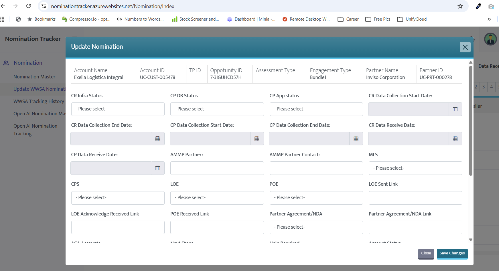

# Nomination Tracker

| | |
|---|---|
| **Source** | Screenshot shared by the user on 2026-10-10: [images/nomination-tracker-update-popup.png](images/nomination-tracker-update-popup.png) |
| **URL** | `nominationtracker.azurewebsites.net`: an **in-house web app hosted on Azure App Service** |
| **Owner** | **Another team** (name ?). The user must coordinate with them for access and updates (Q-033) |
| **Used by** | Sales & marketing / TPMs |
| **Analysed** | 2026-10-10 |



## Its role in the business (as the user explained)
**Leads come from Microsoft through [Partner Center](partner-center.md) and are handled in the Nomination Tracker.** Each record is a nomination for a customer account, tied to a Microsoft opportunity ID and a partner. Admin wants to know **what's happening with the leads**.

```
Microsoft ──lead──▶ Partner Center ──(Excel upload, manual)──▶ Nomination Tracker ──▶ UnifyCloud work (assessments, LOE/POE, agreements…)
                                                                ▲
                                     AI reads emails & fills fields (D-014)
```

## Menu (left navigation)
- Nomination
  - Nomination Master
  - Update WWSA Nomination
  - WWSA Tracking History
  - Open AI Nomination Ma… *(cut off; Master?)*
  - Open AI Nomination Tracking

## "Update Nomination" popup: fields seen
The popup **scrolls**, so these are only the fields visible in the screenshot. The kickoff mentions 50+, so more exist below (Q-008).

### Header (read-only)
| Field | Example value |
|---|---|
| Account Name | Exelia Logistica Integral |
| Account ID | UC-CUST-005478 |
| TP ID | *(empty)* |
| Opportunity ID | 7-3IGUHCD57H |
| Assessment Type | *(empty)* |
| Engagement Type | Bundle1 |
| Partner Name | Inviso Corporation |
| Partner ID | UC-PRT-000278 |

### Editable fields
The last column is **Claude's guess**, to check with the owning team.

| # | Field | Type | Where AI might find the value |
|---|---|---|---|
| 1 | CR Infra Status | Dropdown | Emails/updates about the infrastructure assessment |
| 2 | CP DB Status | Dropdown | Emails/updates about the database assessment |
| 3 | CP App status | Dropdown | Emails/updates about the application assessment |
| 4 | CR Data Collection Start Date | Date | Email: "we've started collecting data…" |
| 5 | CR Data Collection End Date | Date | Email / meeting |
| 6 | CP Data Collection Start Date | Date | Email / meeting |
| 7 | CP Data Collection End Date | Date | Email / meeting |
| 8 | CR Data Receive Date | Date | Email with data attached or shared |
| 9 | CP Data Receive Date | Date | Email with data attached or shared |
| 10 | AMMP Partner | Text | Email threads with the partner |
| 11 | AMMP Partner Contact | Text | Email sender/recipient (Entra / email) |
| 12 | MLS | Dropdown | ? |
| 13 | CPS | Dropdown | Central Provisioning System? |
| 14 | LOE | Dropdown | Email with the LOE sent or acknowledged |
| 15 | POE | Dropdown | Email with the POE received |
| 16 | LOE Sent Link | Text (link) | SharePoint/OneDrive link in the sent email |
| 17 | LOE Acknowledge Received Link | Text (link) | Customer's reply email / attachment |
| 18 | POE Received Link | Text (link) | Email attachment / SharePoint |
| 19 | Partner Agreement/NDA | Dropdown | Email / SharePoint document |
| 20 | Partner Agreement/NDA Link | Text (link) | SharePoint link |
| 21 | ACA Accounts *(partly hidden)* | ? | ? |
| 22 | Next Steps *(partly hidden)* | ? | Meeting transcripts, emails |
| 23 | Help Required *(partly hidden)* | ? | Emails, chats |
| 24 | Account Status *(partly hidden)* | ? | ? |
| … | *More below the scroll* | | |

## Terms: Claude's guesses, please confirm (Q-037)
> ⏸ **Deferred (D-023):** the user will go through these when we design the Nomination Tracker data source.

| Term | Guess |
|---|---|
| CR | **CloudRecon**: UnifyCloud's infrastructure discovery/assessment tool? |
| CP | **CloudPilot**: UnifyCloud's application & database assessment tool? |
| AMMP | **Azure Migration and Modernization Program**, Microsoft's funding program for partners |
| WWSA | ? |
| LOE | Letter of Engagement? |
| POE | Proof of Execution (proof for Microsoft that the funded work was done)? |
| MLS | ? |
| CPS | Central Provisioning System? |
| TP ID | TPID: Microsoft's "Top Parent ID" for a customer organisation |
| Opportunity ID (`7-…`) | Microsoft's opportunity/referral ID? |
| Engagement Type ("Bundle1") | ? |
| "Open AI Nomination" | A separate nomination track for Azure OpenAI engagements? |
| ACA | ? |

## What this means for us
1. **It's a custom app on Azure**, so it almost certainly has its own database. Reading and writing through the owning team (API or database) is probably possible. Coordinate with them early (Q-033).
2. **Most fields are statuses, dates and links.** Those are well suited to AI extraction from emails, attachments and SharePoint links.
3. **We need the full field list**, including the ones below the scroll, with each field's meaning and allowed dropdown values (Q-008, Q-037).
4. **Leads tracking for Admin** can be built on Nomination Tracker data: status per account, stuck items, next steps (Q-040).
