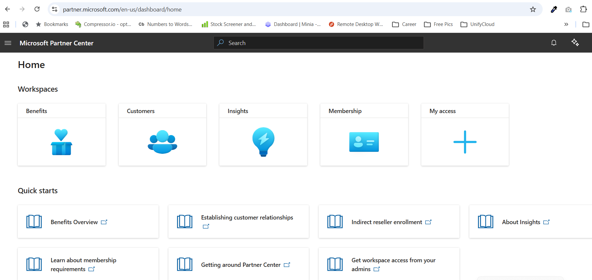

# Microsoft Partner Center

| | |
|---|---|
| **Source** | Screenshot shared by the user on 2026-10-10: [images/partner-center-home.png](images/partner-center-home.png) |
| **URL** | `partner.microsoft.com/en-us/dashboard/home` |
| **What it is** | Microsoft's portal for partner companies like UnifyCloud |
| **Analysed** | 2026-10-10 |

## What the user said
- **UnifyCloud gets leads from Microsoft** here, and they're **handled through the [Nomination Tracker](nomination-tracker.md)**.
- **Admin should be able to see what's happening with the leads.**

## What the screenshot shows
Workspaces visible to the user's account: **Benefits, Customers, Insights, Membership, My access**. Quick starts: Benefits overview, Establishing customer relationships, Indirect reseller enrollment, About Insights, Membership requirements, Getting around Partner Center, Get workspace access from your admins.

## To research / verify
- **Where do the leads appear?** In Partner Center, Microsoft's leads and co-sell opportunities usually sit in a **"Referrals"** workspace. It isn't on this home page, possibly because this account doesn't have access ("My access" / "Get workspace access from your admins"). *To verify.*
- **API:** Partner Center has APIs, including one for referrals, which could pull leads in automatically. *To verify which ones fit and what access they need.*
- **Today's flow (answered 2026-10-10):** the user believes **someone uploads an Excel file into the Nomination Tracker**, so it's a manual step. If the Partner Center API works for us, the app could automate this later.
- **Who at UnifyCloud has Partner Center access** and owns this process? (Q-018)
